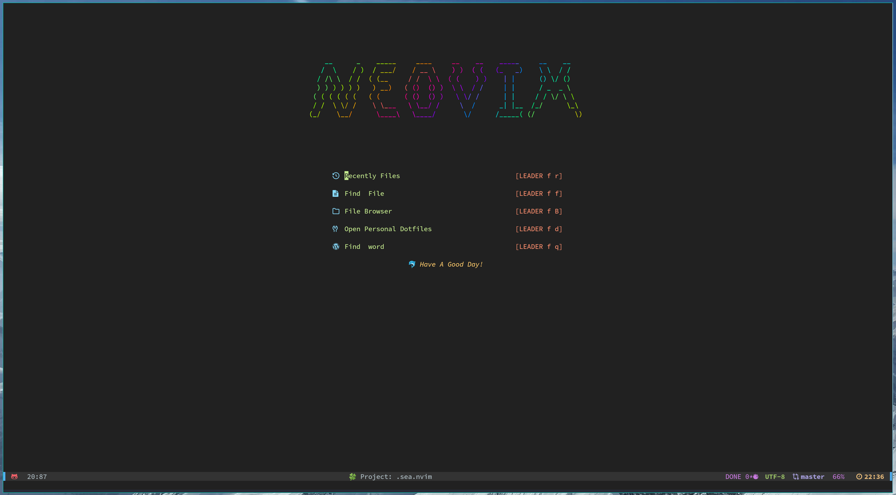
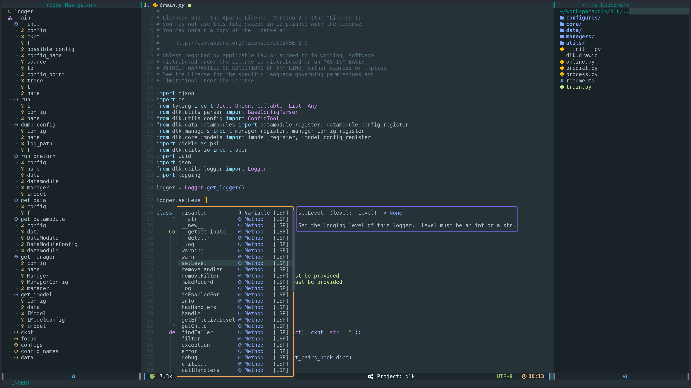
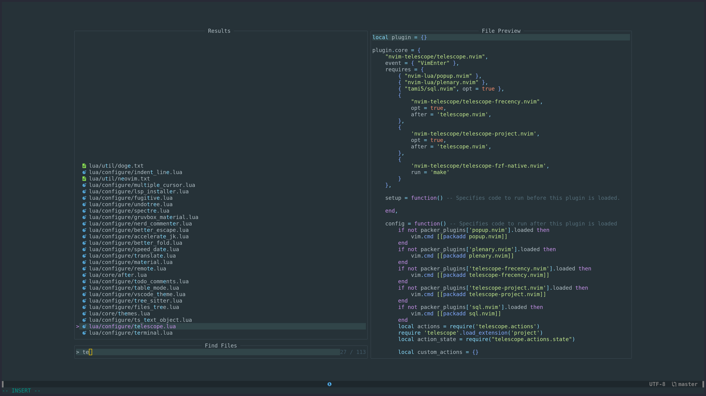
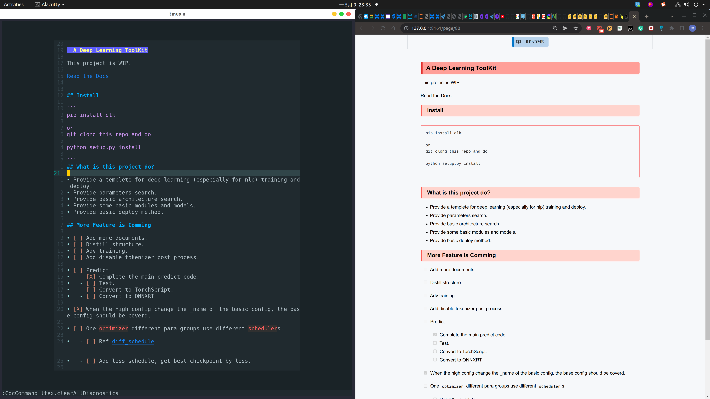
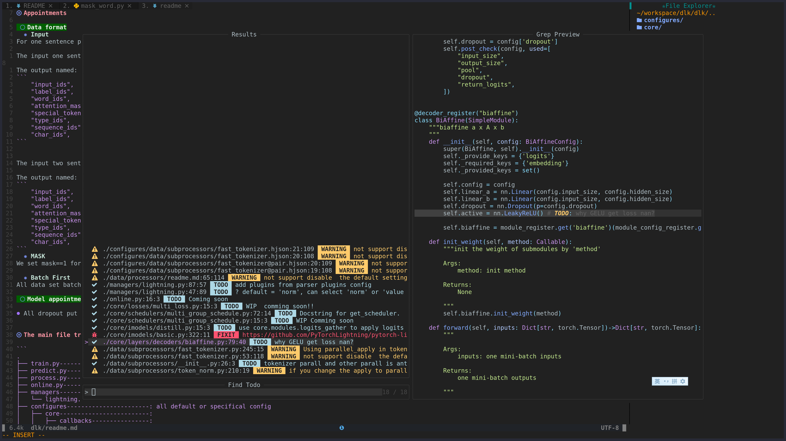
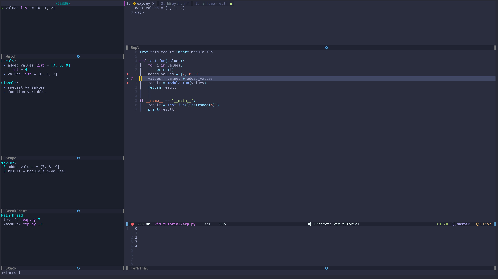
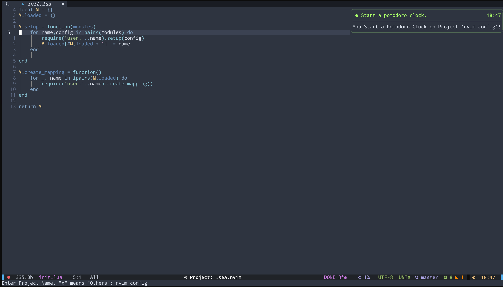

# .sea.nvim

> Always work in progress.

Personal Neovim configuration built around `lazy.nvim`, native LSP, Treesitter,
Mason, Telescope, and a feature-group based plugin layout.



## Highlights

- Neovim 0.11 native LSP configuration with explicit start/stop commands.
- Lazy-loaded plugins organized by feature groups.
- Mason-managed language servers, formatters, and linters (debugpy comes from pip).
- Telescope-based file, project, buffer, history, and mapping search.
- C/C++, Lua, Python, SQL, JSON, Markdown, Vimwiki, and Obsidian workflows.
- Avante and CodeCompanion integration.
- Enhanced Vim help pages through `helpview.nvim`.
- DAP, Git, terminal, session, Pomodoro, and clipboard-image support.

## Requirements

Required:

- Neovim >= 0.11
- Git >= 2.19
- Node.js >= 22
- `rg` (ripgrep)
- `make` for native Telescope extensions
- A Nerd Font is recommended

Node.js is used by TypeScript tooling, ESLint, Markdown preview, and other
Node-based plugins.

### macOS

```bash
brew install neovim git ripgrep make node@22
```

### Ubuntu/Debian

```bash
sudo apt update
sudo apt install neovim git ripgrep build-essential
```

The Neovim version provided by an older distribution may be too old. In that
case, install a current release from the
[official Neovim releases](https://github.com/neovim/neovim/releases).
Install Node.js 22 or newer from your distribution's current packages, the
[official releases](https://nodejs.org/en/download), or a version manager.

## Installation

This configuration expects the repository to live at `~/.sea.nvim`.

```bash
git clone --branch main https://github.com/cstsunfu/.sea.nvim.git ~/.sea.nvim
cd ~/.sea.nvim
./install.sh
```

The install script links the entry point to `~/.config/nvim/init.lua`. Start
Neovim and install/update the plugins with:

```vim
:Lazy sync
```

Useful diagnostics after installation:

```vim
:checkhealth
:checkhealth helpview
```

## Optional dependencies

### Python integration and debugging

```bash
python3 -m pip install pynvim debugpy
```

Update `python3_host_prog` in `lua/core/user.lua` if Python is not installed at
`~/miniconda3/bin/python3`.

### Clipboard images

Install the tool matching the current platform:

- macOS: `brew install pngpaste`
- X11: `xclip`
- Wayland: `wl-clipboard`

### Dashboard logo

The dashboard can render its logo through `lolcat`:

```bash
# macOS
brew install lolcat

# Ubuntu/Debian
sudo apt install lolcat
```

Set `NO_LOLCAT=1` to disable the external command:

```bash
export NO_LOLCAT=1
```

### Telescope frecency database

Telescope frecency uses SQLite. On Ubuntu/Debian:

```bash
sudo apt install sqlite3 libsqlite3-dev
```

## Configuration layout

```text
.
├── compiler/                  Compiler settings
├── ftplugin/                  Filetype-specific settings
├── init.lua                  Neovim entry point and lazy.nvim bootstrap
├── install.sh                Creates links under ~/.config/nvim
├── lua/
│   ├── configure/            One module per plugin
│   │   └── lsp_config/       Native LSP server configuration
│   ├── core/
│   │   ├── default.lua       Options, autocmds, and leader keys
│   │   ├── init.lua          Startup sequence and feature groups
│   │   ├── mapping.lua       Central keymap registration
│   │   ├── plugins.lua       Plugin groups and lazy.nvim setup
│   │   ├── themes.lua        Theme selection
│   │   ├── user.lua          General user settings
│   │   └── local.lua         Machine-local settings, ignored by Git
│   ├── hack/                 Local features such as Pomodoro
│   └── util/                 Shared utilities
└── tasks.ini                 AsyncTasks definitions
```

Every plugin module under `lua/configure/` exposes a Lazy plugin specification
and an optional mapping function. Feature groups are switched on/off in
`lua/core/init.lua`; which plugin belongs to which group, and whether it is
enabled inside that group, is set in `lua/core/plugins.lua`.

## Personal settings

General settings live in `lua/core/user.lua`. Machine-specific settings can be
placed in the ignored `lua/core/local.lua` file:

```lua
local M = {}

M.setup = function()
    vim.g.global_proxy_port = nil
end

M.after = function()
end

return M
```

Both functions are optional at runtime because the local module is loaded with
`pcall`, but defining both keeps the file consistent with the expected module
interface.

The theme can be selected through `GLOBAL_THEME`:

```bash
GLOBAL_THEME=light nvim
```

Without this variable, Material Palenight is used.

## LSP

The default configuration uses Neovim's built-in LSP. Change
`vim.g.feature_groups.lsp` in `lua/core/init.lua` to `"coc"` to use coc.nvim,
or set it to `false` to disable the LSP group.

Language servers are registered through the Neovim 0.11 `vim.lsp.config()` API.
The main lifecycle commands are:

| Command | Mapping | Description |
| --- | --- | --- |
| `:LspStartCurrent` | `;ls` | Start configured LSP clients for the current buffer |
| `:LspStopAll` | `;lS` | Stop all active LSP clients |
| `:LspStopInactive` | — | Stop clients that are not attached to loaded buffers |
| `:Mason` | `;lc` | Open Mason |

## Formatting

Formatting is provided by `conform.nvim`; the formatter binaries are installed
by `mason-tool-installer` (see `lua/configure/mason_install.lua`):

| Filetype | Formatter |
| --- | --- |
| Lua | `stylua` |
| Python | `isort`, then `black` |
| SQL | `sql-formatter` |
| C/C++ | `clang-format` |
| JavaScript/TypeScript/JSX/TSX | `prettierd` |
| JSON/JSONC/CSS/SCSS/HTML/YAML/Markdown | `prettierd` |

Use `;=` to format manually. Automatic formatting can be controlled with:

```vim
:FormatDisable
:FormatDisable!
:FormatEnable
```

## TypeScript

TypeScript and TSX use Treesitter for syntax highlighting, `ts_ls` for LSP
completion and type diagnostics, `prettierd` for formatting, and ESLint LSP
when the project contains an ESLint configuration. Install the runtime tools
in each project so their versions follow the project's `package.json`:

```bash
npm install --save-dev --save-exact typescript@5.9.3 tsx@4.23.12
```

Add ESLint to projects that use it. The installed ESLint version should match
the project's configuration and plugins.

The standard quick-task mappings automatically dispatch TypeScript files to
TypeScript-specific tasks:

| Mapping | Task | Description |
| --- | --- | --- |
| `;qb` | `typescript-check` | Run project type checking with `tsc --noEmit` |
| `;qr` | `typescript-run` | Run the current TypeScript file with `tsx` |

Both tasks prefer project-local executables. For temporary standalone files,
they fall back to the fixed TypeScript and `tsx` versions managed under
Neovim's data directory (`~/.local/share/nvim/typescript-tools` by default).
Project roots are detected from package-manager lockfiles, `tsconfig.json`,
`package.json`, or VCS markers.
Useful LSP commands include `:LspTypescriptSourceAction`,
`:LspTypescriptGoToSourceDefinition`, and `:LspEslintFixAll` (when ESLint is
active). General code actions and symbol rename are mapped to `;la` and `;lr`.

## Helpview

`helpview.nvim` automatically renders Neovim help buffers. Open help normally:

```vim
:help lua
```

Preview control commands include:

```vim
:Helpview Toggle
:Helpview Enable
:Helpview Disable
```

## Main features

Screenshots may use older plugin versions or a different colorscheme.

### Completion, file tree, and code navigation



### Fuzzy search



### Markdown, Vimwiki, and Obsidian



### Project TODO



### Debug Adapter Protocol



### Pomodoro clock



## Key mappings

The leader key is `;`, the local leader is `Space`, and `'` is mapped to `;` in
normal and visual mode.

Mappings are registered centrally and checked for conflicts during startup.
Press a leader prefix to browse groups with WhichKey, or use `;fm` to search all
active mappings with Telescope.

Frequently used mappings:

| Mapping | Description |
| --- | --- |
| `;ff` | Find files |
| `;fq` | Live grep |
| `;fb` | Find buffers |
| `;fr` | Find recent files/history |
| `;fp` | Find projects |
| `;fm` | Search all mappings |
| `;ft` | Toggle file tree |
| `;f.` | Reveal the current file in the tree |
| `;ss` | Save current buffer |
| `;sa` | Save all buffers |
| `;=` | Format current buffer or selection |
| `;aa` | Toggle Avante |
| `;qc` / `;qo` | Close/open QuickFix |
| `;bn` / `;bp` | Next/previous buffer |
| `;bd` | Delete current buffer |
| `gd` / `gr` / `gi` | Definition/references/implementation |
| `]e` / `[e` | Next/previous diagnostic |

For best rendering and responsiveness, a GPU-accelerated terminal such as
[Kitty](https://github.com/kovidgoyal/kitty) or
[Alacritty](https://github.com/alacritty/alacritty) is recommended.
